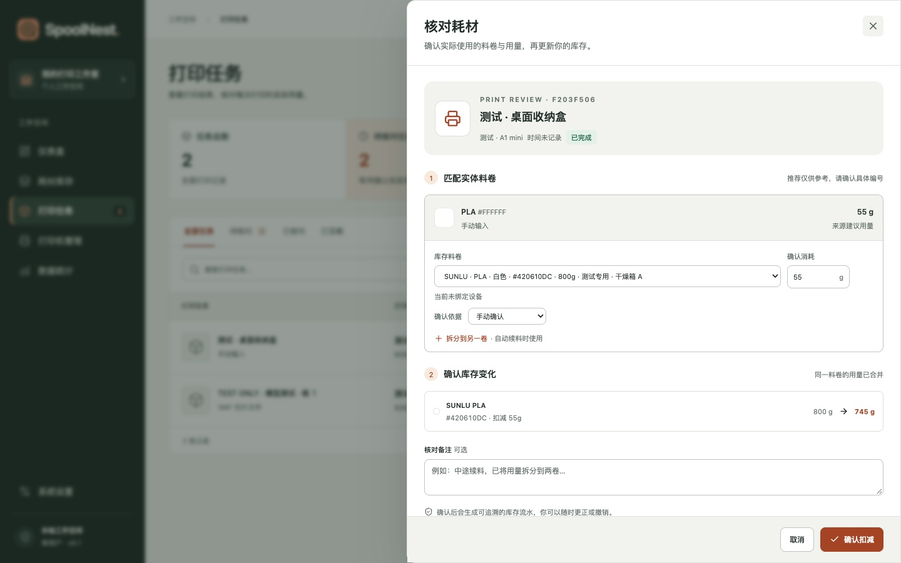

# SpoolNest

**3D Printing Filament Manager** · 简体中文 · 单用户自托管

管理每一卷 3D 打印耗材，通过人工核对，把打印任务的材料用量准确记到实体料卷上。

> SpoolNest 负责整理任务、材质、颜色和报告用量；你确认实际使用的品牌、料卷和重量；只有确认后，库存才会变化。



截图来自隔离测试数据库。首次启动的正式数据库为空，没有示例库存或模拟设备数据。

## 当前可用能力

- 独立产品规格与实体料卷，批量录入、编辑、归档、搜索/筛选/排序、颜色展示、低库存提醒。
- 手动打印任务、Bambu Studio / OrcaSlicer 已切片 3MF 的逐板、逐材料导入。同文件重复导入去重，实际再次打印可明确创建新记录。
- 核对 Drawer：手动选具体料卷、修改重量、一种材料拆分多卷、多材料原子扣减、库存预览。
- 更正与撤销：恢复原影响，再重新记账；追加流水，不抹去历史。
- 幂等键、任务版本检查、SQLite `BEGIN IMMEDIATE`、余额校验，防止重复提交和并发超扣。
- A1 mini 的 AMS lite / 外置手动绑定；X2D 左主喷嘴 / 右辅助喷嘴及用户维护的供料拓扑；安装与卸载历史、按任务开始时间生成的历史快照。
- 数据库仪表盘、按天/周/月/年/品牌/材料/设备/颜色/料卷统计、任务材料成本。
- CSV 导入/导出、重量校准、在线一致性备份、离线恢复、浅色/深色主题、移动端适配。
- 默认关闭的实验性拓竹云端历史读取，分批分页、稳定 ID 去重、断点继续、认证错误与部分成功提示。

**真实拓竹云端连接尚未实机验收。** 适配器通过公开社区源码与合成测试验证了字段解析，不代表你的 A1 mini / X2D 已成功连接。喷嘴协议映射、历史可访问范围与实际返回字段必须用你的授权设备验证。没有实现 LAN 状态订阅、远程控制或自动后台定时同步。详见 [Bambu 接入技术报告](docs/bambu-integration.md)。

## 本机启动（macOS / Linux）

需要 Node.js **24.x** 和 npm。Apple Silicon 原生支持，不需要外部数据库服务。

```bash
git clone https://github.com/BiangMax/SpoolNest.git
cd SpoolNest
npm ci
cp .env.example .env
npm run db:migrate
npm run dev
```

开发网页：[http://127.0.0.1:5173](http://127.0.0.1:5173)。API 在 `127.0.0.1:4310`，Vite 代理 `/api`。如果修改 API 端口，请同步调整 `apps/web/vite.config.ts` 的代理目标。

生产构建和运行：

```bash
npm run build
npm start
```

打开 [http://127.0.0.1:4310](http://127.0.0.1:4310)。Fastify 同时提供编译后的网页和 API。启动时自动执行已版本化的 SQL 迁移；`db:migrate` 可提前执行。升级前先备份。

Node 24 的内置 `node:sqlite` 在部分小版本仍输出实验性 API 提示，因此运行版本限定为 Node 24，避免跨主版本差异。项目使用原生 SQLite + 共享 Zod 校验，而非 Prisma，减少 Apple Silicon 和 Docker 的外部引擎依赖。

## 第一次使用

1. 在「耗材库存」添加 SUNLU PLA 白色：标称 1000g、剩余 800g、价格 ¥60。
2. 在「打印机管理」添加实际设备，按需手动绑定每个槽位的实体料卷。
3. 在「打印任务」导入已切片的 3MF，或手动录入已完成任务与建议消耗 55g。
4. 3MF 只代表切片估算，默认打印状态为未知；请核实并更新结果，或明确确认实际用量。
5. 点击「核对耗材」，手动选择具体 SUNLU 料卷，确认 800g → 745g。
6. 查看料卷流水 `-55g`。重复提交不会再次扣减；撤销后恢复 800g，另留 `+55g` 恢复流水。

没有逐材料重量时，不按比例猜测。未知、失败、取消任务不预填完整建议扣减，需要手动输入并确认。打印中任务禁止库存核对。耗材用尽或归档并不删除历史。余量百分比可能大于 100%，用于如实反映用户的称重校准；视觉进度条限制在 100%。

## 拓竹云端：用户选择启用

此功能使用**非公开社区接口**，不是官方稳定 API。可能随时变更、受限或失效；没有账号密码登录器，不绕过设备授权。

在本机受保护的 `.env` 中配置你合法获得的令牌：

```dotenv
BAMBU_EXPERIMENTAL=true
BAMBU_REGION=cn
BAMBU_ACCESS_TOKEN=your-authorized-token
```

全球区使用 `BAMBU_REGION=global`。重启服务后，在「系统设置」阅读风险说明并勾选授权，点击启用。通过设备序列号关联任务；序列号未匹配时保留任务并显示设备未关联，不猜测机型。每次同步最多 5 页，每页最多 50 条；有更多记录时点击「继续历史批次」。最近刷新重新从首页读取，通过数据库唯一键去重。

Token 仅存在环境变量和服务进程内存中，不写入数据库、不发送给网页、不记录到日志。断开授权会关闭集成并清除当前进程令牌；同时请自行从 `.env` 或部署环境移除 Token，并按提供方方式撤销授权。不要把 Token 发到 issue、聊天或 GitHub。实机测试步骤见 [接入报告](docs/bambu-integration.md#启用实验性云端前的用户步骤)。

云端任务 `weight` 与 `amsDetailMapping` 是报告值，绝不能称为精确实测。未知 AMS 映射显示原始索引；喷嘴未知就保持为空。官方 X2D 硬件的双喷嘴事实，不代表协议已自动识别。

在「系统设置」点击「同步云端库存」后，已有料卷的重量差异按“本地旧数据 → 云端新数据”逐卷展示。核实后点击该行「同步」，即可将这一卷本地余量更新为右侧云端报告值，并追加来源为 `cloud_report` 的重量校准流水。读取差异本身不会覆盖已有重量，按钮不向云端写入数据，也不自动核对历史打印任务。如果对照后本地料卷又有变更，需要重新读取云端库存后再确认。云端报告值不等于称重实测。

对照也会显示本地在库卷数与本次云端返回卷数，列出未关联云端或本次云端未返回的本地料卷，等待你选择「保留本地」或「归档」。保留决定会存入本地数据库，后续对照仍展示但不再作为待裁定项；归档移出在库统计，保留重量、历史与流水，可在库存“已归档”中恢复。云端未返回不等于料卷已被删除，程序不会自动删除本地料卷。已安装料卷需先解绑才能归档。

## CSV 库存交换

在库存页导出当前列表（导出包含全部料卷，含归档）。CSV 新增格式示例见 [docs/spools-example.csv](docs/spools-example.csv)。必填列：

```text
brand,productName,material,colorHex,netG,remainingG
```

可选列：`subtype,colorName,colorCode,emptyG,price,purchasedAt,openedAt,location,status,notes`。重量单位 g，价格单位人民币元。`status` 为 `sealed/opened/empty/archived`。空价格保持缺失，不按 0 元处理。导入最多 1000 行、2 MB，整批校验并原子录入。

导出带 `spoolId`，直接重导会拒绝，防止误造重复库存。如果这是实际新购料卷，明确移除 ID 列后再导入。CSV 不用于恢复完整工作空间；恢复请使用数据库备份。公式前缀导出时会转义以减少电子表格公式注入风险。

## 备份与恢复

设置页可以在线下载一致性 SQLite 快照，也可以运行：

```bash
npm run backup
```

输出到忽略于 Git 的 `backups/`。**不要在运行中只复制 `.db` 主文件**，WAL 可能含尚未 checkpoint 的数据。

恢复先正常停止所有 SpoolNest 进程：

```bash
npm run restore -- /absolute/path/spoolnest-backup.db --server-stopped
npm start
```

恢复检查完整性、外键和版本，拒绝检测到仍在使用的 WAL/SHM。已有目标数据库会另存为 `.before-restore-时间戳.db`。不要手工删除 WAL 来强行通过检查。备份含私人工作室记录，请妥善保存；并非加密备份。

## Docker / NAS

```bash
cp .env.example .env
# 在 .env 中设置至少 32 字符、随机生成的 ADMIN_TOKEN
# 可用 node -e "console.log(require('crypto').randomBytes(32).toString('hex'))" 本机生成

docker compose up -d --build
```

打开 [http://localhost:4310](http://localhost:4310)，输入管理员令牌。Compose 默认只把端口发布到宿主机 `127.0.0.1`。容器内必须监听 `0.0.0.0`，因此必须配置强令牌。数据库和备份使用命名卷；删除卷会丢失数据。

如需局域网或 HTTPS 反向代理，自行明确修改端口绑定并配置 `PUBLIC_ORIGIN` 为完整访问源（例如 `https://spoolnest.example.com`，无末尾斜线）。API 校验 Host、Origin 和管理员令牌。不在公网直接裸露服务；远程使用应配置 TLS。前端访问令牌仅存在当前页面内存，刷新后重新输入。

```bash
docker compose exec spoolnest npm run backup
docker compose logs --tail=100 spoolnest
docker compose down
```

镜像采用非 root 用户、Node 24，支持 arm64 / amd64。CI 会构建镜像并检查容器启动；本地没有 Docker 时不能把提交了 Dockerfile 视为已在本机运行验收。

## 开发与验证

```bash
npm test
npm run typecheck
npm run build
npm run format:check
```

测试数据全部使用内存或临时 SQLite，不访问生产数据库和真实云端。覆盖单/多材料、幂等、100 次重复同步、库存不足整体回滚、更正换卷、撤销再核对、续料拆分、双喷嘴、历史快照、失败任务、并发 API、认证、3MF/云端保守解析和 CSV 校验。截图和手动浏览器验收也使用独立测试库。

- [架构与数据约束](docs/architecture.md)
- [Bambu 可行性与来源研究](docs/bambu-integration.md)
- [验收与剩余边界](docs/validation.md)
- [实施清单](docs/roadmap.md)

```text
apps/web                  Vue 3、Pinia、Router、R​​eka UI、Lucide、CSS tokens
apps/server               Fastify API、事务业务、版本化 SQL migrations
packages/shared           请求 schema、领域类型、标签与重量换算
packages/printer-adapters  实验云端、3MF；只读，不控制设备
scripts                   迁移、备份、恢复
tests                     隔离的单元与 API 集成测试
```

这是面向单用户小型工作室的初版。当前 API 一次加载工作空间，超大库存需要后续服务端分页；不是多人协同系统。中文标签集中管理，保留 locale 设置，尚无完整英文翻译。图表由真实流水绘制，价格/净重不完整时明确显示缺失。

提交采用 [Conventional Commits](https://www.conventionalcommits.org/)。许可：[MIT](LICENSE)。
